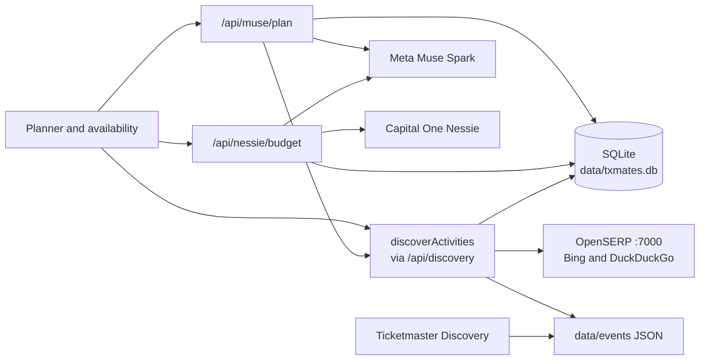

# TXMates

Plan a hangout your friends will actually make.

[](https://nextjs.org)
[](https://www.typescriptlang.org)
[](https://react.dev)
[](https://tailwindcss.com)
[](https://nodejs.org/api/sqlite.html)

TXMates is a Next.js friend-hangout planner. One person sets the day, the shared hours, and a per-person budget. Friends mark when they are free. The app folds that overlap into a short itinerary you can reorder, swap, and lock.

The demo squad is “The goobers” in Austin, on 2026-10-26, at $50 a person. The working app is in [`friend-hangout`](friend-hangout). Discover can follow the hangout city, and Austin also has a committed calendar of upcoming events.

## Screenshots

The organizer view: overlap across the afternoon, the three plan strategies, and the start of a locked-ready schedule.


A friend marking hours. Full green means everyone is free, a lighter green means some are, and an empty cell means nobody is.


## Features

- **Shared hours, on a green scale.** The overlap runner and the availability page paint each hour from an empty surface, through a light green, to solid leaf green when everyone is free. In light mode the empty cell is the off-white sheet color. In dark mode that empty cell is a dark surface. Each cell also shows a count and the words None, Some, or Everyone.
- **A link friends can answer.** `/avail/[id]` is the personal page. The demo link is `/avail/txmates-demo`. Submissions are stored with the hangout and the organizer view polls for them.
- **Three ways to look at the same day.** Overall, cheapest, and best interest match. `lib/planner.ts` scores a city catalog. With `MUSE_API_KEY` set, `/api/muse/plan` asks Meta Muse Spark (`muse-spark-1.3`) to pick up to three stops and write the rationale, an icebreaker, and a coordination tip. Those picks are stored in SQLite.
- **A per-person budget from Capital One Nessie.** The server reads one customer’s accounts, purchases, and bills. Checking balances count. Credit-card balances count as money already owed. Savings balances stay out of spendable cash, and a repeating transfer into savings is treated as already set aside. The suggestion keeps a 10% buffer (at least $50) and caps the hangout share. If the key is missing or Nessie fails, the cap stays a $50 estimate and the page says so. Typing a different number keeps later reads from overwriting it.
- **Search that follows the city.** Discover has a city field and calls OpenSERP on port 7000 through `/api/discovery`. Curated catalogs exist for Austin, San Antonio, Dallas, and Boston. Another city gets a generated set of generic venues named for that city. A shortlist can be applied back as selected interests. Clicking an itinerary stop opens the same city list so you can swap that stop.
- **An Austin event calendar.** `friend-hangout/data/events/local` holds things to do. `friend-hangout/data/events/shows` holds concerts and sports. Each file is one event. Austin search merges events that have not ended before today in America/Chicago, and labels them as calendar cards. A price that was not on the source page stays “Price not listed.”
- **An itinerary you can edit, then keep.** Drag a handle to reorder, use the arrow buttons, and click a stop to swap it. Locking the itinerary writes the snapshot to SQLite and downloads a PNG. Votes on the plan stay in the browser until you refresh.

## Tech stack

| Piece | What it is |
| --- | --- |
| App | Next.js 16 (App Router), React 19, TypeScript 5 |
| UI | Tailwind CSS 4, Lucide, Familjen Grotesk |
| Plan copy, picks, and budget wording | Meta Muse Spark, model `muse-spark-1.3`, `https://api.meta.ai/v1` |
| Budget figures | Capital One Nessie, `https://api.nessieisreal.com` |
| Activity search | [OpenSERP](https://github.com/karust/openserp) on `127.0.0.1:7000`, Bing and DuckDuckGo |
| Extra Austin listings | Ticketmaster Discovery API, optional |
| Database | Node.js built-in `node:sqlite`, file `friend-hangout/data/txmates.db` |
| Event files | JSON under `friend-hangout/data/events/` |

## Architecture

The browser talks only to the Next.js app. API keys stay on the server.



**Muse** writes plan copy and up to three stop picks in `/api/muse/plan`. That route first asks the discovery library for the hangout city, then caches a successful synthesis. `/api/nessie/budget` asks Muse to rewrite a real Nessie estimate in plain language. Listing enrichment (event or place, dates, venue, cost, category, tags) lives in `lib/discoverySearch.ts` and runs from search refresh and from `npm run refresh:activities`.

**Nessie** is read from `/api/nessie/budget`. Spendable cash is checking minus credit-card balances. `savingsBalance` is reported and kept out of that cash. `plannedMonthlySavings` is subtracted before the hangout suggestion. `/api/nessie/check` is a separate connectivity probe and defaults to `http://api.nessieisreal.com`. The budget client defaults to `https://api.nessieisreal.com`.

**OpenSERP** answers activity and event search unless `SEARCH_PROVIDER=serpapi`. `/api/discovery` calls `lib/discoverActivities.ts`, which calls `/mega/search` with `engines` from `OPENSERP_ENGINES`. The example file sets `duckduckgo,bing`. If that variable is unset, the code sends `bing,duckduckgo`. Google stays off that pair because a cold three-engine search often runs past the timeout. Saved rows for the city load from SQLite first. A search older than `ACTIVITY_CACHE_TTL_HOURS` (default 8, allowed 1–24) refreshes in the background. The `openserp/` directory in this repo is empty. Run the server yourself.

Set `SEARCH_PROVIDER=serpapi` and `SERPAPI_API_KEY` to use [SerpApi](https://serpapi.com) instead. The app calls `https://serpapi.com/search.json` with `engine=google` and `engine=google_local`, then keeps the same junk filter, wrong-city filter, cache, and demo fallback. The key stays on the server and is not logged. If `SEARCH_PROVIDER=serpapi` and the key is missing, search logs a warning and uses OpenSERP. Any other value, including leaving it unset, also uses OpenSERP.

The city field on Discover is sent as the location. If the search text itself names `dallas`, `boston`, `san antonio`, `houston`, `chicago`, `new york`, `nyc`, `austin`, `seattle`, `denver`, `miami`, `atlanta`, `los angeles`, `san francisco`, or `orlando`, that name replaces the location for the request. Austin, San Antonio, Dallas, and Boston fall back to curated lists. Any other city falls back to generated venue templates from `generateDynamicCityActivities`.

**SQLite** (`friend-hangout/data/txmates.db`) stores hangouts, friend availability, the locked itinerary, Muse plan picks, the Muse call log, and saved OpenSERP rows. `lib/activityStore.ts` is the retention policy the refresh script uses:

- An OpenSERP event row is removed once its end date, or its start date when there is no end, is before today. An event with no date is removed `ACTIVITY_EVENT_TTL_DAYS` after it was last seen (default 30).
- A place stays until a recheck cannot find its name or URL, or until it has gone unseen for `ACTIVITY_PLACE_STALE_DAYS` (default 60). That row is marked `unlisted` and then deleted.

**The Austin calendar** is separate from those SQLite rows. JSON files in `data/events/local` and `data/events/shows` are committed. Discover merges a file into Austin results when its end date, or its start date when there is no end, is today or later in America/Chicago. An undated file stays in the folder and stays in search. `npm run events:prune` deletes only files that have already ended, prints each removal, and does nothing on a second run. Undated and unreadable files are left alone. `.github/workflows/prune-events.yml` runs that prune every day at 11:15 UTC and can also run `npm run events:collect` when the repository secret `TICKETMASTER_API_KEY` exists. Collect adds Ticketmaster music, sports, and arts listings for Austin. It does not invent events and does not delete ones already saved. The workflow can push only when Actions has read and write permission on contents.

## Getting started

### Prerequisites

- Node.js 20.9 or newer (Next.js 16), and npm
- Optional: a Capital One Nessie API key, a Meta Muse API key, a Ticketmaster Discovery API key, and a SerpApi key
- Optional: an OpenSERP binary if you want live search. It is not vendored here

The app still plans a day with no keys. Nessie falls back to a $50 estimate, Muse copy stays on the built-in sentences, and Discover serves saved rows plus the city catalog when live search is down.

### Install

```bash
cd friend-hangout
npm install
cp .env.example .env.local
```

### Environment

Put secrets in `friend-hangout/.env.local` only. Names and placeholders, matching [`friend-hangout/.env.example`](friend-hangout/.env.example):

```bash
NESSIE_API_KEY=
NESSIE_BASE_URL=https://api.nessieisreal.com
NESSIE_CUSTOMER_ID=
NESSIE_ACCOUNT_ID=

OPENSERP_URL=http://127.0.0.1:7000
OPENSERP_TIMEOUT_MS=15000
OPENSERP_ENGINES=duckduckgo,bing
SEARCH_PROVIDER=openserp
SERPAPI_API_KEY=

MUSE_API_KEY=
MUSE_BASE_URL=https://api.meta.ai/v1
MUSE_MODEL=muse-spark-1.3
MUSE_TIMEOUT_MS=25000
MUSE_CACHE_TTL_HOURS=12
MUSE_MAX_CALLS_PER_DAY=200

ACTIVITY_CACHE_TTL_HOURS=8
ACTIVITY_EVENT_TTL_DAYS=30
ACTIVITY_PLACE_STALE_DAYS=60
ACTIVITY_PLACE_RECHECK_DAYS=30
ACTIVITY_RECHECK_LIMIT=8
ACTIVITY_LOCATION=Austin, TX

TICKETMASTER_API_KEY=
```

Leave the keys empty until you have them. Do not prefix `NESSIE_API_KEY`, `MUSE_API_KEY`, `TICKETMASTER_API_KEY`, or `SERPAPI_API_KEY` with `NEXT_PUBLIC_`. `NESSIE_CUSTOMER_ID` and `NESSIE_ACCOUNT_ID` are optional pins. The commented defaults in `.env.example` are public URLs and timeouts, not credentials.

`/api/discovery` reads `SEARCH_PROVIDER`, `SERPAPI_API_KEY`, `OPENSERP_URL`, `OPENSERP_TIMEOUT_MS`, and `OPENSERP_ENGINES`. The budget route reads the `NESSIE_*` variables. Budget wording and listing enrichment read the `MUSE_*` variables through `lib/museClient.ts`. `/api/muse/plan` reads `MUSE_API_KEY`, `MUSE_BASE_URL`, and `MUSE_MODEL`, and it uses the plan cache TTL. `TICKETMASTER_API_KEY` is read by `npm run events:collect` and by the end of `npm run refresh:activities`.

`npm run nessie:seed` creates a demo customer, a checking account, purchases, and monthly and annual bills on the key in `.env.local`. It prints the new ids and does not print the key.

### Run OpenSERP

From the folder that contains the OpenSERP binary:

```bash
openserp serve -a 127.0.0.1 -p 7000
```

On Windows, from a prebuilt release:

```bat
openserp.exe serve -a 127.0.0.1 -p 7000
```

A library request looks like this:

```text
http://127.0.0.1:7000/mega/search?engines=duckduckgo,bing&text=Austin%20TX&limit=12&mode=any
```

The first search for a new phrase can take about 15 seconds (`OPENSERP_TIMEOUT_MS`, default 15000, capped at 30000). Later visits to that phrase read the saved rows.

### Dev, test, lint, and build

From `friend-hangout`:

```bash
npm run dev      # http://localhost:3000
npm test
npm run lint
npm run build
npm start        # after build
```

Friend hours for the demo hangout: [http://localhost:3000/avail/txmates-demo](http://localhost:3000/avail/txmates-demo).

```bash
npm run refresh:activities   # expired SQLite rows, stale searches, quiet places, then Ticketmaster collect
npm run events:prune         # delete calendar files that already ended
npm run events:collect       # add Ticketmaster listings when the key is set
```

Add `--force` to `refresh:activities` to refresh searches that are still inside the cache window. `ACTIVITY_LOCATION` defaults to `Austin, TX`.

## Project structure

```text
.
├── README.md
├── PRODUCT.md
├── docs/
├── .github/workflows/prune-events.yml
├── openserp/                         # empty; the search server is not in this repo
└── friend-hangout/
    ├── .env.example
    ├── package.json
    ├── app/
    │   ├── page.tsx                  # organizer planner
    │   ├── avail/[id]/page.tsx
    │   └── api/
    │       ├── discovery/            # OpenSERP or SerpApi, plus the city and event catalogs
    │       ├── muse/plan/            # Muse picks and copy
    │       ├── nessie/               # budget and a connectivity check
    │       └── hangouts/             # SQLite hangouts and availability
    ├── components/                   # form, overlap scale, itinerary, discovery
    ├── lib/                          # planner, Nessie, Muse, activity store, event catalog
    ├── scripts/                      # nessie:seed, refresh:activities, events:prune, events:collect
    └── data/
        ├── txmates.db                # created on first run and gitignored
        └── events/
            ├── local/                # committed things to do
            └── shows/                # committed concerts and sports
```

## Muse daily cap and caching

Outbound Muse calls that go through `lib/museClient.ts` share one local-day cap. Budget wording and listing enrichment use that client.

- `MUSE_MAX_CALLS_PER_DAY` defaults to 200. An explicit value is capped at 1000. `0` turns those calls off.
- Both successful and failed outbound calls count. A cache hit does not.
- Each call is logged in `muse_calls` with prompt, completion, and total tokens when the API returns them.
- A successful completion is stored in `muse_response_cache` for `MUSE_CACHE_TTL_HOURS` (default 12, maximum 168).
- `/api/muse/plan` calls Muse on its own, waits 15 seconds, and does not check that daily cap. A synthesis it can read is written to `muse_plan_cache` for the same 12-hour TTL, keyed by the hangout, the view, and the candidate list. The next identical request comes back from SQLite.

When the cap is spent, the budget sentence stays on the calculated wording and the page says the daily limit was reached. Plan picks still come from the plan cache or from a fresh plan call.

## Known issues

- **A new search briefly shows unrelated results.** Discover keeps the previous cards on screen while the next request is in flight, including after the city changes. The status line says that list is the last answer, not the new one. A query that does not match saved names can also return the wider saved list for that city.
- **Some categories are mislabeled.** Keyword guesses in `lib/discoverySearch.ts` are loose (`golf` lands in gaming, and anything unmatched lands in chill). A category filter stamps that category onto every new OpenSERP row.
- **Generic fallback picks are cached for 12 hours.** If Muse returns fewer than three usable ids, `/api/muse/plan` pads the list with the next candidates and stores that mix in `muse_plan_cache` for `MUSE_CACHE_TTL_HOURS` (default 12). The same inputs then replay those picks. A cached row whose ids are no longer in the candidate list falls back to the first three candidates.
- **“You plus 4 friends.”** The demo group is four people, and the organizer is already one of them. The plan prompt sends that `friendCount` plus every name, then Muse speaks to the person planning the day. The copy can say “you plus 4 friends,” which counts the organizer twice. The header on the page says “4 mates.”

## Credits

TXMates is a hackathon project in [JeffOfTheSixPaths/TXMates](https://github.com/JeffOfTheSixPaths/TXMates). Commit history includes work by Orion and Gohith.

- [Meta Muse Spark](https://api.meta.ai/v1) for plan picks, plan copy, budget wording, and listing enrichment
- [Capital One Nessie](https://api.nessieisreal.com/documentation) for the per-person budget read
- [OpenSERP](https://github.com/karust/openserp) for self-hosted search, with Bing and DuckDuckGo
- [SerpApi](https://serpapi.com) as the optional second search provider
- [Ticketmaster Discovery API](https://developer.ticketmaster.com/) for optional Austin listings
- Next.js, React, Tailwind CSS, Lucide, and Familjen Grotesk

Venue names in the Austin, San Antonio, Dallas, and Boston catalogs are real places used as demo content. Prices, hours, and ratings in those lists are estimates. Other cities use generated venue templates. Product notes for design work live in [`PRODUCT.md`](PRODUCT.md).
