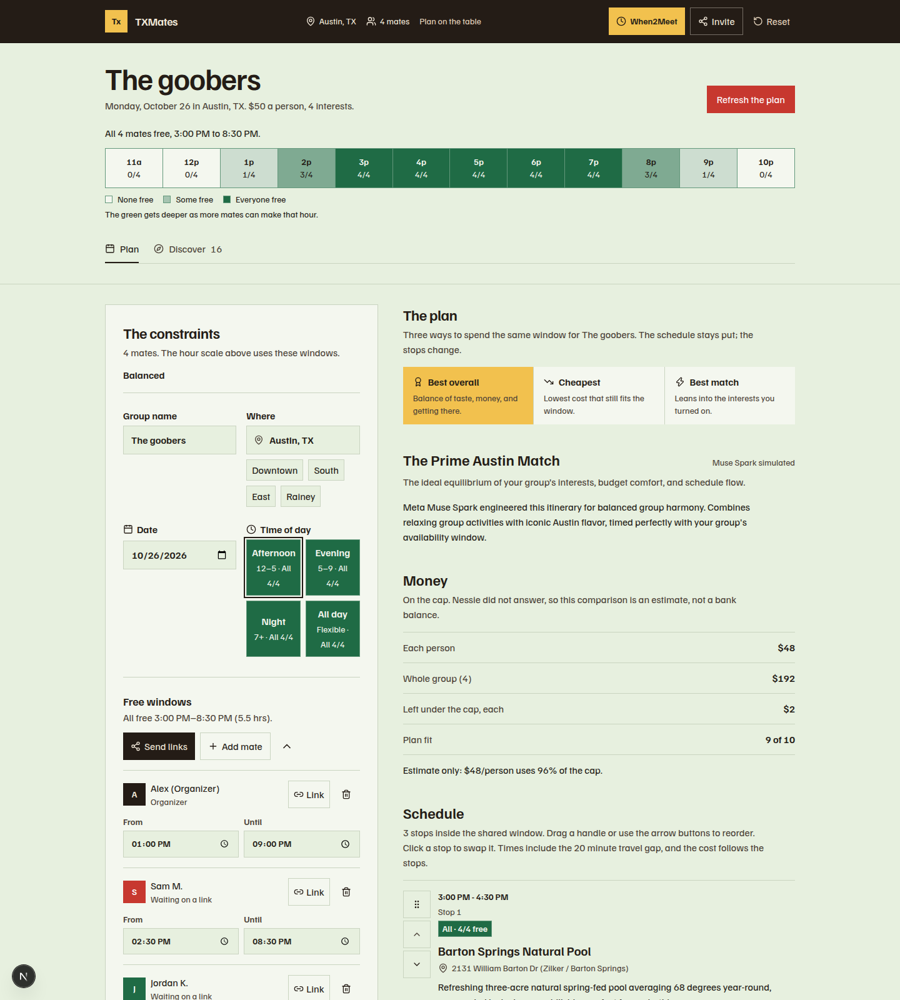
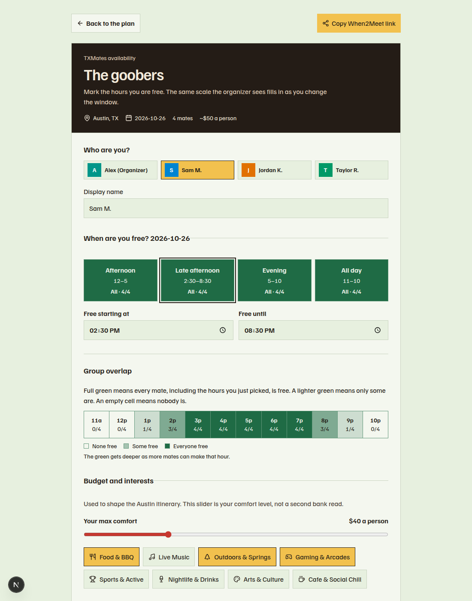
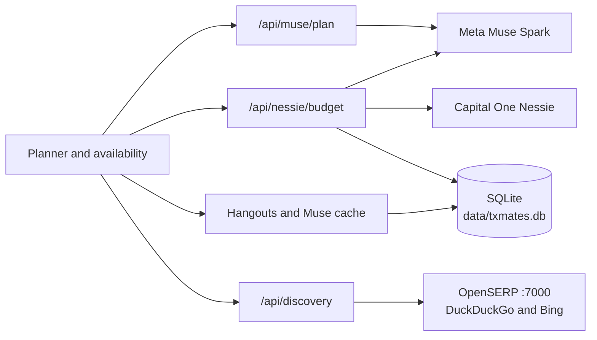

# TXMates

Plan a hangout your friends will actually make.

[](https://nextjs.org)
[](https://www.typescriptlang.org)
[](https://react.dev)
[](https://tailwindcss.com)
[](https://nodejs.org/api/sqlite.html)

TXMates is a Next.js friend-hangout planner. One person sets the day, the shared hours, and a per-person budget. Friends mark when they are free. The app folds that overlap into a short itinerary you can reorder, swap, and lock.

The demo squad is “The goobers” in Austin, on 2026-10-26, at $50 a person. The working app is in [`friend-hangout`](friend-hangout).

## Screenshots

The organizer view: overlap across the afternoon, the three plan strategies, and the start of a locked-ready schedule.



A friend marking hours. Full green means everyone is free, a lighter green means some are, and an empty cell means nobody is.



## Features

- **Shared hours, on a green scale.** The overlap runner and the availability page paint each hour from an empty surface, through a light green, to solid leaf green when everyone is free. In light mode the empty cell is the off-white sheet color. In dark mode that empty cell is a dark surface. Each cell also shows a count and the words None, Some, or Everyone.
- **A link friends can answer.** `/avail/[id]` is the personal page. The demo link is `/avail/txmates-demo`. Submissions are stored with the hangout and the organizer view polls for them.
- **Three ways to look at the same day.** Overall, cheapest, and best interest match. `lib/planner.ts` scores the curated catalog. With `MUSE_API_KEY` set, Meta Muse Spark (`muse-spark-1.3`) writes the rationale, an icebreaker, and a coordination tip.
- **A per-person budget from Capital One Nessie.** The server reads one customer’s accounts, purchases, and bills. Checking balances count. Credit-card balances count as money already owed. Savings balances stay out of spendable cash, and a repeating transfer into savings is treated as already set aside. The suggestion keeps a 10% buffer (at least $50) and caps the hangout share. If the key is missing or Nessie fails, the cap stays a $50 estimate and the page says so. Typing a different number keeps later reads from overwriting it.
- **Activity search through self-hosted OpenSERP.** Discover calls a local server on port 7000. A shortlist can be applied back as selected interests. Clicking an itinerary stop opens the same city list so you can swap that stop.
- **An itinerary you can edit, then keep.** Drag a handle to reorder, use the arrow buttons, and click a stop to swap it. Locking the itinerary writes the snapshot to SQLite and downloads a PNG. Votes on the plan stay in the browser until you refresh.

## Tech stack

| Piece | What it is |
| --- | --- |
| App | Next.js 16 (App Router), React 19, TypeScript 5 |
| UI | Tailwind CSS 4, Lucide, Familjen Grotesk |
| Plan copy and budget wording | Meta Muse Spark, model `muse-spark-1.3`, `https://api.meta.ai/v1` |
| Budget figures | Capital One Nessie, `https://api.nessieisreal.com` |
| Activity search | [OpenSERP](https://github.com/karust/openserp) on `127.0.0.1:7000` |
| Database | Node.js built-in `node:sqlite`, file `friend-hangout/data/txmates.db` |

## Architecture

The browser talks only to the Next.js app. API keys stay on the server.



**Muse** is used in two places. `/api/muse/plan` asks Muse Spark for the rationale, icebreaker, and coordination tip. `/api/nessie/budget` asks it to rewrite a real Nessie estimate in plain language. Listing enrichment (event or place, dates, venue, cost, category, tags) lives in `lib/discoverySearch.ts` and runs from `npm run refresh:activities`.

**Nessie** is read only from `/api/nessie/budget`. Spendable cash is checking minus credit-card balances. `savingsBalance` is reported and kept out of that cash. `plannedMonthlySavings` is subtracted before the hangout suggestion. `/api/nessie/check` is a separate connectivity probe and defaults to `http://api.nessieisreal.com`. The budget client defaults to `https://api.nessieisreal.com`.

**OpenSERP** answers activity and event search. `lib/discoverySearch.ts` calls `/mega/search` with `engines=duckduckgo,bing` (override with `OPENSERP_ENGINES`). The Discover page calls `/api/discovery`, which hits the same `/mega/search` path and leaves the engine list to the OpenSERP process. The `openserp/` directory in this repo is empty. Run the server yourself.

**SQLite** stores hangouts, friend availability, the locked itinerary snapshot, the Muse call log, and the Muse response cache. The activity tables are created in the same file. `lib/activityStore.ts` is the retention policy the refresh script uses:

- An event is removed once its end date, or its start date when there is no end, is before today. An event with no date is removed `ACTIVITY_EVENT_TTL_DAYS` after it was last seen (default 30).
- A place stays until a recheck cannot find its name or URL, or until it has gone unseen for `ACTIVITY_PLACE_STALE_DAYS` (default 60). That row is marked `unlisted` and then deleted.

## Getting started

### Prerequisites

- Node.js 20.9 or newer (Next.js 16), and npm
- Optional: a Capital One Nessie API key and a Meta Muse API key
- Optional: an OpenSERP binary if you want live search. It is not vendored here

The app still plans a day with no keys. Nessie falls back to a $50 estimate, Muse copy stays on the built-in sentences, and Discover needs OpenSERP for live cards.

### Install

```bash
cd friend-hangout
npm install
cp .env.example .env.local
```

### Environment

Put secrets in `friend-hangout/.env.local` only. Names and placeholders, matching [`friend-hangout/.env.example`](friend-hangout/.env.example):

```bash
NESSIE_API_KEY=
NESSIE_BASE_URL=https://api.nessieisreal.com
NESSIE_CUSTOMER_ID=
NESSIE_ACCOUNT_ID=

OPENSERP_URL=http://127.0.0.1:7000
OPENSERP_TIMEOUT_MS=15000
OPENSERP_ENGINES=duckduckgo,bing

MUSE_API_KEY=
MUSE_BASE_URL=https://api.meta.ai/v1
MUSE_MODEL=muse-spark-1.3
MUSE_TIMEOUT_MS=25000
MUSE_CACHE_TTL_HOURS=12
MUSE_MAX_CALLS_PER_DAY=200

ACTIVITY_CACHE_TTL_HOURS=8
ACTIVITY_EVENT_TTL_DAYS=30
ACTIVITY_PLACE_STALE_DAYS=60
ACTIVITY_PLACE_RECHECK_DAYS=30
ACTIVITY_RECHECK_LIMIT=8
ACTIVITY_LOCATION=Austin, TX
```

Leave the keys empty until you have them. Do not prefix `NESSIE_API_KEY` or `MUSE_API_KEY` with `NEXT_PUBLIC_`. `NESSIE_CUSTOMER_ID` and `NESSIE_ACCOUNT_ID` are optional pins. The commented defaults in `.env.example` are public URLs and timeouts, not credentials.

`/api/discovery` reads `OPENSERP_URL`. The budget route reads the `NESSIE_*` variables. Budget wording and the refresh script read the `MUSE_*` and `ACTIVITY_*` variables. `/api/muse/plan` reads `MUSE_API_KEY`, `MUSE_BASE_URL`, and `MUSE_MODEL`.

`npm run nessie:seed` creates a demo customer, a checking account, purchases, and monthly and annual bills on the key in `.env.local`. It prints the new ids and does not print the key.

### Run OpenSERP

From the folder that contains the OpenSERP binary:

```bash
openserp serve -a 127.0.0.1 -p 7000
```

On Windows, from a prebuilt release:

```bat
openserp.exe serve -a 127.0.0.1 -p 7000
```

The library request looks like this:

```text
http://127.0.0.1:7000/mega/search?engines=duckduckgo,bing&text=Austin%20TX&limit=12&mode=any
```

DuckDuckGo and Bing are the default engine pair. Google is left off that default because a cold three-engine search often runs past the timeout (`OPENSERP_TIMEOUT_MS`, default 15000, capped at 30000). The Discover route uses a 3.5 second timeout and does not send `engines`.

### Dev, test, lint, and build

From `friend-hangout`:

```bash
npm run dev      # http://localhost:3000
npm test
npm run lint
npm run build
npm start        # after build
```

Friend hours for the demo hangout: [http://localhost:3000/avail/txmates-demo](http://localhost:3000/avail/txmates-demo).

`npm run refresh:activities` deletes expired rows, refreshes stale searches through OpenSERP, and rechecks quiet places. Add `--force` to refresh searches that are still inside the cache window. `ACTIVITY_LOCATION` defaults to `Austin, TX`.

## Project structure

```text
.
├── README.md
├── PRODUCT.md
├── docs/
├── openserp/                  # empty; the search server is not in this repo
└── friend-hangout/
    ├── .env.example
    ├── package.json
    ├── app/
    │   ├── page.tsx           # organizer planner
    │   ├── avail/[id]/page.tsx
    │   └── api/
    │       ├── discovery/     # OpenSERP search
    │       ├── muse/plan/     # Muse rationale
    │       ├── nessie/        # budget and a connectivity check
    │       └── hangouts/      # SQLite hangouts and availability
    ├── components/            # form, overlap scale, itinerary, discovery
    ├── lib/                   # planner, Nessie math, Muse client, activity store
    ├── scripts/               # nessie:seed and refresh:activities
    ├── data/                  # txmates.db is created here and gitignored
    └── types/
```

## Muse daily cap and caching

Outbound Muse calls that go through `lib/museClient.ts` share one local-day cap.

- `MUSE_MAX_CALLS_PER_DAY` defaults to 200. An explicit value is capped at 1000. `0` turns those calls off.
- Both successful and failed outbound calls count. A cache hit does not.
- Each call is logged in `muse_calls` with prompt, completion, and total tokens when the API returns them.
- A successful completion is stored in `muse_response_cache` for `MUSE_CACHE_TTL_HOURS` (default 12, maximum 168). The same inputs return the saved text.
- Budget wording uses this path. So does listing enrichment inside the refresh script.
- `/api/muse/plan` calls Muse directly, waits 12 seconds, and does not check the cap or the cache.

When the cap is spent, the budget sentence stays on the calculated wording and the page says the daily limit was reached.

## Known issues

- **A new search briefly shows unrelated results.** Discover keeps the previous cards on screen while the next request is in flight. The status line says that list is the last answer, not the new one.
- **Some categories are mislabeled.** Keyword guesses are loose (`play` and `golf` land in gaming, `live` lands in music, everything else lands in chill). A category filter writes that category onto every hit while the visible label stays the guess, so the two can disagree.
- **Generic fallback picks are cached for 12 hours.** The itinerary starts as three scored catalog stops. Budget wording and enrichment replies that pass through `museComplete` are stored for `MUSE_CACHE_TTL_HOURS` (default 12), so a generic reply is what the next identical request gets. `lib/museCache.ts` can store plan picks, including a fill-in of the first three candidates, for that same window.
- **“You plus 4 friends.”** The demo group is four people, and the organizer is already one of them. The plan prompt sends that `friendCount` plus every name, then Muse speaks to the person planning the day. The copy can say “you plus 4 friends,” which counts the organizer twice. The header on the page says “4 mates.”
- **Discover’s catalog fallback does not load.** `/api/discovery` imports `getActivitiesForLocation` from `lib/mockData.ts`. That function is not exported, so the route fails to load when OpenSERP is down and the curated list never returns. Saved rows, event expiry, and place unlisting still run from `npm run refresh:activities`.

## Credits

TXMates is a hackathon project in [JeffOfTheSixPaths/TXMates](https://github.com/JeffOfTheSixPaths/TXMates). Commit history includes work by Orion and Gohith.

- [Meta Muse Spark](https://api.meta.ai/v1) for plan copy, budget wording, and listing enrichment
- [Capital One Nessie](https://api.nessieisreal.com/documentation) for the per-person budget read
- [OpenSERP](https://github.com/karust/openserp) for self-hosted search, with DuckDuckGo and Bing
- Next.js, React, Tailwind CSS, Lucide, and Familjen Grotesk

Venue names in `lib/mockData.ts` are real Austin places used as demo content. Prices, hours, and ratings in that file are estimates. Product notes for design work live in [`PRODUCT.md`](PRODUCT.md).
